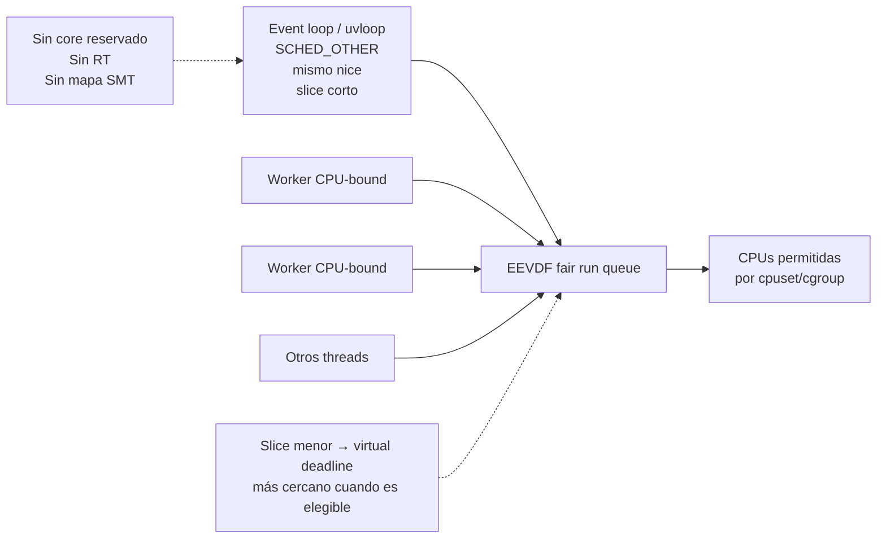
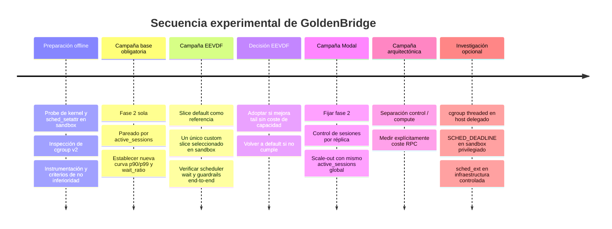

# Alternativas de diseño para eliminar la contención del event loop de GoldenBridge sin recurrir a A1/A2/B

## Resumen ejecutivo

Partiendo de cero y **excluyendo deliberadamente afinidad de CPU, `nice` y `SCHED_FIFO/RR`**, mi recomendación principal es investigar primero una vía que Linux incorporó recientemente y que encaja de forma sorprendentemente precisa con el problema: **mantener el event loop en la clase normal `SCHED_OTHER`, pero darle un _time slice_ EEVDF explícitamente más corto mediante `sched_setattr()`**. Desde Linux 6.12, el parámetro `sched_runtime` puede expresar un _custom slice_ para `SCHED_OTHER`/`SCHED_BATCH`; EEVDF usa el tamaño del slice al calcular el _virtual deadline_, de modo que los trabajos sensibles a latencia con slices menores pueden resultar elegibles antes sin recibir por ello una reserva permanente de CPU ni pasar a una clase de tiempo real. citeturn14search4turn13search14turn13search13

La propiedad que hace especialmente atractiva esta vía para GoldenBridge es que **ataca la demora de despacho, no la capacidad disponible**. El loop seguiría compartiendo todas las CPUs que le permita el cpuset de Modal, seguiría en la clase fair y conservaría el mismo `nice`; lo que cambia es la granularidad con la que EEVDF le entrega CPU cuando está runnable. En el código upstream actual de Linux, modificar parámetros de una tarea de clase fair del mismo propietario sólo entra en la comprobación `CAP_SYS_NICE` si se intenta reducir su `nice`; el `sched_runtime` del fair scheduler se guarda como `p->se.slice`. Por tanto, es razonable esperar que un thread pueda cambiar **su propio slice** sin `CAP_SYS_NICE` en un kernel upstream, aunque esto es una **inferencia del código del kernel, no una garantía sobre Modal**: seccomp, LSM o el kernel efectivo del contenedor todavía pueden rechazar el syscall. citeturn18view0turn17view0

Mi orden de preferencia sería:

| Prioridad | Ruta | Razón |
|---|---|---|
| **Primera** | **EEVDF + custom slice del loop** | Intervención mínima y directamente orientada a wakeup/run-queue latency; no reserva CPUs, no depende de SMT y probablemente no requiere privilegios |
| **Segunda** | **Control de densidad por contenedor + scale-out en Modal** | Resuelve el problema por capacidad: impide que una instancia llegue a la zona de saturación pero conserva throughput global añadiendo réplicas |
| **Fallback arquitectónico** | **Separar control plane y compute plane** | Saca físicamente los hilos CPU-heavy del dominio de planificación del loop; más caro arquitectónicamente, pero muy robusto |
| Experimental | cgroup v2 threaded CPU QoS | Excelente técnicamente si el cgroup está delegado; mala portabilidad a un contenedor serverless |
| Experimental privilegiada | `SCHED_DEADLINE` con CBS | Ofrece una reserva CPU acotada, mucho más controlable que FIFO/RR, pero requiere privilegios y tiene problemas con cpusets |
| Infra/R&D | `sched_ext`/BPF | Máximo control sobre la política de scheduling, pero requiere dominio del host/kernel; no es una solución razonable desde un tenant de Modal |

La segunda conclusión importante es metodológica: **ninguna de estas rutas debe medirse en tráfico antes de la campaña de fase 2 sola**. Esa es la única dependencia del análisis anterior que considero imprescindible conservar. §6 exige que `OPENBLAS_NUM_THREADS=1` y `OMP_NUM_THREADS=1` tengan su propia campaña antes de introducir otro mecanismo, porque de otro modo se pierde la atribución causal. También conservaría como imprescindibles `active_sessions` como variable de pareado y las métricas end-to-end como guardrail, porque el propio histórico ya demostró que una métrica interna del loop puede mejorar mientras el sistema global empeora. fileciteturn0file0

El dato previo de que una solución concreta funcionó **no entra en esta recomendación**. No uso como premisa ni el mapa de CPUs, ni el SMT, ni los resultados de A1/A2/B. La investigación siguiente pregunta otra cosa: *¿cómo conseguir que un hilo corto e interactivo consiga CPU a tiempo sin restar capacidad efectiva a los trabajos largos?*

## Punto de partida, supuestos y criterio de decisión

El único modelo causal que hace falta asumir es muy pequeño: cuando el event loop está runnable pero no ejecutándose, su retraso aparece en `schedstat` como tiempo de espera; el objetivo solicitado es reducir ese retraso y sus consecuencias p90/p99 sin trasladar la cola a workers, `inbox` o latencia de turno. La manera de obtener `schedstat`, la necesidad de usar deltas del mismo PID y el pareado por `active_sessions` ya están documentados para GoldenBridge. fileciteturn0file0

No hace falta asumir que el host de Modal tendrá la misma topología que producción. De hecho, las rutas que priorizo deliberadamente **no necesitan conocer CPUs lógicas, parejas SMT ni NUMA**. EEVDF opera dentro de las CPUs que la tarea ya pueda utilizar, mientras que Modal expresa sus reservas de CPU en **cores físicos**, y documenta que un request de CPU garantiza al contenedor al menos esa cantidad de capacidad; también existe un límite configurable de CPU. citeturn13search0

Los constraints que no aparecen definidos quedan así:

| Dimensión | Estado para este análisis |
|---|---|
| Objetivo p90/p99 y `schedstat wait_ratio` | **Constraint explícito** |
| No degradar throughput/capacidad | **Constraint explícito** |
| Modal / cpuset variable / privilegios limitados | **Constraint explícito** |
| Orden de §6 | **Constraint explícito y vinculante** |
| Topología SMT concreta | **No constraint**; las rutas preferidas no deben depender de ella |
| Versión exacta del kernel Modal | **No constraint especificado; supuesto que debe verificarse** |
| Presupuesto económico de más réplicas | **No constraint** |
| Límite de cambio arquitectónico | **No constraint** |
| Latencia adicional admisible por IPC/RPC | **No constraint**; por eso debe medirse antes de adoptar separación |
| Margen numérico aceptable de regresión de throughput | **No constraint**; debe fijarse antes de la campaña para hacer una prueba formal de no inferioridad |

Para ordenar alternativas usaría un criterio lexicográfico en vez de fabricar una puntuación arbitraria:

**primero**, debe ser desplegable en Modal sin privilegios especiales o tener una variante que lo sea; **segundo**, no debe conseguir latencia sacrificando CPU de los workers; **tercero**, cuanto más directamente ataque la espera runnable→running, mejor; **cuarto**, debe poder desactivarse limpiamente; y sólo después entran complejidad y madurez empírica.

Esta jerarquía favorece cambios dentro del scheduler fair o cambios de arquitectura que aumenten capacidad antes que mecanismos que simplemente trasladan CPU de un componente a otro.

Hay además un cambio de Linux relevante respecto de muchas discusiones históricas sobre CFS. Linux comenzó la transición desde CFS a **EEVDF** a partir de 6.6. EEVDF mantiene un concepto de lag para preservar reparto justo de CPU y, entre las tareas elegibles, selecciona el menor virtual deadline; la documentación del kernel dice explícitamente que slices más cortos permiten favorecer la capacidad de respuesta de tareas sensibles a latencia. citeturn13search14turn13search13 El origen del algoritmo está en el trabajo EEVDF de Stoica y Abdel-Wahab de 1995, al que remite la propia documentación del kernel. citeturn13search5

Eso abre una alternativa que no existía en la misma forma en generaciones anteriores del scheduler.

## Rutas alternativas investigadas

**Ruta EEVDF: custom slice únicamente para el event loop.**  
El mecanismo consiste en dejar el thread principal en `SCHED_OTHER`, mismo `nice`, mismo cpuset y misma capacidad, pero pedirle al fair scheduler un slice menor con `sched_setattr(... sched_runtime=...)`. Desde Linux 6.12, util-linux documenta ese uso de `sched_runtime` como longitud de slice personalizada para `SCHED_OTHER` y `SCHED_BATCH`. El código actual del kernel además devuelve `p->se.slice` como `sched_runtime` para las tareas no RT y detecta explícitamente un cambio de ese campo como modificación de parámetros del fair scheduler. citeturn14search4turn17view0

La lógica es diferente de “darle más CPU” al loop. Bajo EEVDF, el reparto justo sigue determinado por el modelo de lag/weight; un slice menor modifica su virtual deadline y, por tanto, su latencia de despacho. Esa separación entre **latencia** y **entitlement** es precisamente lo que necesita GoldenBridge: el loop parece necesitar poca CPU total, pero esa CPU tiene gran valor cuando está runnable. citeturn13search14



**Supuesto:** el kernel real de Modal es ≥6.12 y expone esta funcionalidad. No encontré documentación pública de Modal que garantice una versión de kernel concreta o que prometa este syscall. Éste debe ser un **capability probe**, no una premisa. Si devuelve `EINVAL`, `EPERM` o el `sched_getattr()` posterior no refleja el slice, se descarta limpiamente y se pasa a la siguiente ruta. El código upstream actual sugiere que cambiar sólo el slice fair de una tarea propia no requiere `CAP_SYS_NICE`; no obstante, la política de seguridad del contenedor puede ser más restrictiva. citeturn18view0

El riesgo principal no es starvation de los workers, sino pasarse al otro extremo: slices demasiado pequeños significan decisiones/preempciones más frecuentes y pueden aumentar overhead y alterar localidad de caché. Es justamente por eso que no elegiría un valor “mágico”. Haría un sweep en sandbox —por ejemplo control/default, 4 ms, 2 ms, 1 ms y 0,5 ms como **puntos experimentales, no recomendaciones**— y seleccionaría el menor slice cuyo beneficio de p99 todavía supere su coste en context switches/CPU.

La campaña mínima compara **fase 2 + slice default** contra **fase 2 + un único slice candidato**, manteniendo workers, carga y recursos idénticos. Primarios: distribución por ventanas de `schedstat wait_ratio`, `resume_vad` p90/p99 y, cuando pueda instrumentarse, wakeup→running del TID. Guardrails: `cycle` p90/p99, `turn_end_latency_ms` p90/p99, `inbox` p99, turnos/s, frames, barge-ins, CPU total y cambios de contexto. El análisis debe ser pareado por `active_sessions`. El resultado que validaría la hipótesis es especialmente fuerte si baja el `wait_ratio` p99 **sin** bajar CPU disponible ni throughput del pool.

**Ruta Modal-native: limitar densidad por contenedor y escalar horizontalmente.**  
Aquí no se intenta convencer al kernel de que el loop es especial. Se impide que una única run queue de GoldenBridge acumule suficientes trabajos concurrentes como para entrar en la zona de colapso. La diferencia crítica respecto de “usar menos workers” es que la capacidad que se quita a una réplica se **recupera añadiendo réplicas**; el objetivo es reducir `active_sessions/container`, no `throughput/global`.

Modal documenta que sus Functions escalan mediante múltiples containers y recomienda explícitamente el scale-out entre containers para trabajo CPU-bound; también advierte que la concurrencia elevada dentro de un mismo container puede resultar contraproducente para cargas CPU-bound. citeturn13search12turn20search2turn20search16 Los Servers permiten definir `target_concurrency`, pero Modal aclara que éste es **un límite blando**: un servidor que de verdad no soporte más concurrencia debe implementar su propio load-leveling o load-shedding. citeturn13search4

Por tanto, no usaría `target_concurrency` como garantía por sí solo. Después de la campaña de fase 2 se identifica de nuevo un valor `K` de concurrencia por réplica antes de que crezca la cola del loop, se añade headroom, y las **nuevas sesiones** sólo se asignan a instancias por debajo de ese límite. No asumiría que `K=40`; ese número procede de la situación histórica y la fase 2 puede desplazarlo. fileciteturn0file0

El control tendría esta forma conceptual:

```text
                      nuevas sesiones
                            │
                    ┌───────▼────────┐
                    │ router/admission│
                    │ active_sessions │
                    │ por réplica     │
                    └───┬────┬────┬──┘
                        │    │    │
                 ┌──────▼┐ ┌▼─────┐ ┌▼──────┐
                 │ GB #1 │ │ GB #2│ │ GB #N │
                 │ <= K  │ │ <= K │ │ <= K  │
                 └───────┘ └──────┘ └───────┘

             throughput global = suma de réplicas
             no reducción estática del worker pool
```

Modal permite mantener `min_containers`/`buffer_containers` para reducir la cola causada por cold starts; su propia documentación señala que una petición a un container que aún debe arrancar incurre en latencia adicional, mientras que mantener capacidad caliente cambia coste por latencia. citeturn20search1turn20search7 También permite pedir explícitamente más cores físicos para cada container, lo que da una segunda dimensión de prueba: **más capacidad por réplica** frente a **más réplicas a menor densidad**. citeturn13search0

El riesgo está en el estado de las llamadas: una sesión larga no debería migrarse de container a mitad de conversación salvo que GoldenBridge ya lo soporte. La distribución debe hacerse al establecer la sesión y mantener afinidad lógica de sesión a réplica. También aparecen coste, cold starts y posible desbalance.

El experimento mínimo compara el mismo `active_sessions` **global** con distinta distribución: control, una réplica soportando `N`; tratamiento, varias réplicas con aproximadamente `N/r` cada una. Aquí hacen falta dos estratificaciones: global `active_sessions` para demostrar que la capacidad total no se redujo y `active_sessions/container` para comprobar la hipótesis de densidad. Primarios: wait_ratio y p99 por loop; guardrails: throughput agregado, `inbox`, turn_end, tasa de sesiones rechazadas/encoladas, cold-start/pending latency, CPU física solicitada y coste por turno.

**Ruta de separación estructural: control plane liviano y compute plane independiente.**  
Ésta es la solución más contundente si la contención intraproceso resulta estructural. El proceso que posee sockets, timers, uvloop y estado de conversación deja de alojar threads CPU-heavy. El trabajo caro se envía a otro proceso o, preferentemente en Modal, a otra Function/Server con su propia asignación y autoscaling de CPU. Modal permite que una Function invoque otra directamente y ofrece variantes asincrónicas `remote.aio()`, por lo que el loop puede esperar el resultado sin bloquear su thread. citeturn20search3turn20search4

```text
┌────────────────────────────────┐
│     CONTROL / sesión           │
│  uvloop + sockets + timers     │
│  casi nada de CPU pesada       │
└───────────────┬────────────────┘
                │ llamada async
                ▼
       ┌──────────────────┐
       │ COMPUTE SERVICE  │
       │ pool / inference │
       │ CPU independiente│
       └──────────────────┘
                │
                ▼
           resultado
```

Esto sí cambia fundamentalmente el dominio de interferencia: si ambos componentes viven en containers con requests de CPU independientes, los threads de compute dejan de ocupar el mismo scheduler domain del loop. Modal escala además las Functions independientemente. citeturn20search10turn13search0

No usaría `modal.Queue` para el camino síncrono de VAD/turno: Modal documenta que sus operaciones de Queue requieren red y añaden latencia del orden de decenas de milisegundos. Es apropiada para tareas asíncronas, no para una ruta cuyo presupuesto se mide en milisegundos. citeturn20search0 El hot path debe ser RPC directo/asíncrono, o IPC local si finalmente la separación es por procesos en una misma máquina.

La desventaja es que ahora existe un coste fijo de serialización + RPC. Por eso esta arquitectura sólo gana si el trabajo offloaded es suficientemente grueso o si puede agruparse sin perjudicar latencia. Modal ofrece batching dinámico y explica explícitamente el trade-off: mejora throughput compartiendo trabajo, pero puede aumentar latencia. citeturn20search11 En GoldenBridge no introduciría batching en el loop; como máximo, lo ensayaría dentro del compute plane con un tiempo de espera estricto.

El experimento mínimo instrumenta cada petición con cuatro timestamps: enqueue local, salida RPC, llegada compute y vuelta al loop. Se compara monolito frente a separación, siempre con fase 2, mismo trabajo y `active_sessions` pareadas. La hipótesis sólo se acepta si la reducción de scheduler wait del control plane es mayor que la nueva latencia RPC y el throughput total no baja.

**Ruta cgroup v2 threaded: QoS entre “control” y “compute” dentro del mismo proceso.**  
cgroup v2 permite granularidad por thread para controladores que admiten modo threaded, entre ellos `cpu`; los TID pueden moverse mediante `cgroup.threads` dentro de un subtree threaded. El controlador CPU ofrece `cpu.weight`, que reparte ciclos de forma proporcional, y `cpu.max`, que permite un límite absoluto de ancho de banda. citeturn14search6turn14search3

La construcción sería:

```text
goldenbridge.threaded/
    control/    <- TID del loop
    compute/    <- TIDs de workers

control:  cpu.weight = alto
compute:  cpu.weight = normal
```

Esto no es el mismo mecanismo que subir el `nice` del thread: es **group scheduling jerárquico**. Permite decir que una unidad pequeña de trabajo de control merece una parte mayor del servicio durante contención sin cambiar la política individual de todos sus threads. El primer experimento debe tocar únicamente `cpu.weight`; `cpu.max` sobre workers sería una segunda intervención, porque un cap puede generar throttling y comprometer throughput. El kernel expone precisamente `nr_throttled` y `throttled_usec` en `cpu.stat` para observar ese efecto. citeturn14search3

El gran problema en Modal es operativo. Para mover threads hacen falta permisos de escritura sobre `cgroup.threads` y sobre el ancestro apropiado, y para crear la estructura hace falta que el controlador esté delegado. El kernel describe explícitamente esos requisitos de delegación. citeturn14search6 **Supuesto:** un container Modal normal probablemente no debe darse por supuesto como propietario de un subtree cgroup delegado; no encontré una garantía pública de Modal en ese sentido. Por tanto la ruta comienza con `mountinfo`, `cgroup.controllers`, `cgroup.type` y una escritura inocua en un subtree de prueba. Si no está delegado, esta opción queda descartada sin más.

El experimento mínimo sería control `100:100` versus, por ejemplo, una única relación candidata control:compute seleccionada antes en sandbox. Las cifras concretas son parámetros experimentales, no recomendaciones. Se observan wait_ratio del loop, consumo por cgroup, `nr_throttled`, throughput y cola end-to-end. Esta vía tiene mejor encaje en Linux administrado por vosotros que en serverless.

**Ruta de reserva temporal: `SCHED_DEADLINE` con Constant Bandwidth Server.**  
Ésta merece distinguirse de las políticas RT estáticas. Linux implementa `SCHED_DEADLINE` mediante EDF más Constant Bandwidth Server: una tarea recibe un presupuesto `runtime` cada `period`, utilizable dentro de `deadline`; al consumir el presupuesto se la limita hasta la siguiente reposición. La finalidad explícita del CBS es aislar el ancho de banda de unas tareas respecto de otras. citeturn14search7

Para un event loop eso permite una especificación del estilo conceptual “garantiza hasta Q microsegundos cada P microsegundos”, en lugar de “ejecuta antes que los demás sin límite”. Si el loop se vuelve loco, el presupuesto limita cuánto puede robarle a los workers. Ésa es una propiedad mucho más segura que una prioridad RT ilimitada. citeturn14search7

Pero para Modal tiene dos obstáculos decisivos. Primero, cambiar o establecer `SCHED_DEADLINE` requiere `CAP_SYS_NICE`. citeturn15search6turn18view0 Segundo, el kernel rechaza configuraciones de deadline cuando la máscara de afinidad de la tarea no contiene todo el `root_domain` de scheduling correspondiente, precisamente una condición problemática en entornos con cpusets administrados externamente. citeturn18view0

Por eso la considero una vía de laboratorio privilegiado, no una recomendación de producción Modal. Además, la propia documentación del kernel advierte que parametrizar mal deadline scheduling puede producir comportamiento impredecible o inestable. citeturn14search7

El ensayo correcto tampoco elegiría `runtime/period` a mano. Se mediría primero la distribución real de **CPU service time** consumida por el loop por intervalos cortos y se dimensionaría un presupuesto que cubra los bursts legítimos. Después se observarían deadline overruns/throttling, p99 del loop y throughput. Si un presupuesto pequeño cubre p99 sin interferencia, es evidencia fuerte; si necesita un porcentaje grande de un core, el problema deja de ser meramente “scheduler latency”.

**Ruta `sched_ext`: scheduler BPF específico para workloads interactivos.**  
Desde Linux 6.12, `sched_ext` ofrece una clase extensible en la que programas BPF pueden definir la política de scheduling. Puede activarse/desactivarse dinámicamente y el kernel vuelve al scheduler normal si detecta un error o una tarea runnable atascada; además existe `SCX_OPS_SWITCH_PARTIAL`, que permite aplicar el scheduler extensible sólo a tareas marcadas `SCHED_EXT` en vez de tomar todas las fair tasks. citeturn13search2turn13search7

No sería necesario inventar todo desde cero. El proyecto open source `sched-ext/scx` mantiene schedulers reales; `scx_bpfland`, por ejemplo, clasifica las tareas interactivas según su comportamiento y las coloca en una cola más favorecida, mientras `scx_lavd` estima la criticidad de latencia y la incorpora a deadlines y slices. También existe `scx_rustland`, que lleva gran parte de la política a user space, aunque sus propios mantenedores reconocen el coste de sacar decisiones del kernel. citeturn15search0turn15search2turn15search9turn15search1

Conceptualmente es casi ideal para GoldenBridge: clasificar el TID del loop como latency-critical, mantener los workers como throughput-oriented y diseñar explícitamente un límite de servicio para evitar starvation.

Operativamente es el extremo opuesto. `sched_ext` necesita un kernel compilado con `CONFIG_SCHED_CLASS_EXT` y la infraestructura BPF/BTF correspondiente. citeturn13search2 Cargar un scheduler del host no es una facultad que deba suponerse disponible dentro de un tenant serverless. La considero una opción para infraestructura propia, una VM controlada o una eventual colaboración con el proveedor, no código aplicativo portable a Modal.

Su experimento mínimo sería en una VM que reproduzca GoldenBridge: EEVDF upstream como control versus un scheduler interactivo existente, antes de escribir uno custom. Sólo si un `scx_bpfland`/`scx_lavd` ya reduce p99 sin throughput loss tendría sentido desarrollar una política GoldenBridge-specific. Se medirían los mismos endpoints más estadísticas propias de `scx`, scheduler aborts y fairness de workers. El proyecto `scx` expone herramientas de monitorización de wait/run/context switches precisamente para estas pruebas. citeturn15search0

## Comparación transversal y recomendación priorizada

La tabla siguiente evalúa la solución **en el entorno objetivo**, no sólo su elegancia técnica.

| Alternativa | Portabilidad a Modal | Privilegios | Reversible | Impacto probable en workers | Evidencia disponible | Complejidad | Riesgo de regresión |
|---|---|---:|---:|---|---|---|---|
| **EEVDF custom slice** | **Alta si kernel ≥6.12** | **Probablemente ninguno**, validar syscall | **Muy alta** | **Bajo**: no cambia CPU share nominal | Kernel upstream + EEVDF; poca evidencia GB específica | Baja | **Bajo–medio** |
| **Scale-out + límite por réplica** | **Muy alta** | Ninguno | Alta | **Positivo/neutral globalmente** si se escala capacidad | Modal lo recomienda para CPU-bound | Media | Bajo–medio |
| **Control/compute separados** | Alta | Ninguno | Media | Muy bajo sobre loop; compute independiente | Patrón arquitectónico sólido; RPC específico debe medirse | Alta | Medio |
| cgroup v2 threaded | Baja/incierta | Delegación cgroup | Alta | Puede reducir servicio worker bajo saturación | Kernel upstream | Media | Medio |
| `SCHED_DEADLINE` | **Baja** | `CAP_SYS_NICE` | Alta | Acotable por CBS | Kernel RT maduro | Media–alta | Alto si se parametriza mal |
| `sched_ext` | Muy baja como tenant | Host/BPF/kernel | Alta técnicamente | Configurable | Kernel + implementaciones `scx` reales | **Muy alta** | Alto a nivel infra |

### Recomendación principal: EEVDF custom slice

Es la alternativa con mejor combinación de **directitud causal + conservación de capacidad + reversibilidad + independencia de topología**.

La razón técnica central es importante: no estamos intentando otorgar más capacidad sostenida al loop. Estamos intentando que **una cantidad pequeña de servicio CPU llegue en el momento correcto**. EEVDF separa justamente esos conceptos mediante lag/fairness y virtual deadlines; la documentación del kernel identifica los slices cortos como mecanismo de responsiveness. citeturn13search14

La condición de entrada es binaria y barata:

```text
¿kernel acepta custom sched_runtime para el TID del loop
y sched_getattr confirma el valor?
             │
       ┌─────┴─────┐
      sí           no
      │             │
  experimentar   descartar
      │             │
      ▼             ▼
   EEVDF          scale-out
```

No diseñaría código de producción antes de resolver ese probe.

Y tampoco pondría directamente el slice más pequeño. El optimum será donde se maximice:

\[
\frac{\text{reducción de wait p99 y latencia end-to-end}}
     {\text{context switches + CPU adicional + regresión de throughput}}
\]

No necesitamos conocer de antemano esa curva.

### Segunda opción: mantener cada réplica fuera de la rodilla y escalar

Si EEVDF no está disponible en el kernel de Modal o no mueve el p99 de forma suficiente, pasaría al control de densidad por réplica.

Esta opción tiene una ventaja fundamental: es **provider-native**. Modal permite pedir cores físicos, autoscalar contenedores y mantener capacidad caliente; para CPU-bound recomienda paralelizar mediante containers, y `target_concurrency` permite hacer que el autoscaler responda a la concurrencia observada. citeturn13search0turn13search12turn13search4

Pero para GoldenBridge usaría el autoscaler como mecanismo de provisión, **no como único admission controller**, porque Modal declara explícitamente que el target de Servers es blando. citeturn13search4

La regla se derivaría de la campaña nueva:

\[
K =
\max\{active\_sessions/container :
wait\_ratio_{p99}\ \text{todavía está en régimen sano}\}
\]

y no del antiguo “40”.

### Fallback: separar definitivamente control y compute

Lo elegiría cuando el problema no sea una configuración concreta del scheduler, sino que GoldenBridge combine permanentemente dos clases de carga incompatibles:

```text
control plane: ráfagas cortas, deadlines humanos, poca CPU total
compute plane: trabajos largos, throughput, alta ocupación
```

Separarlos en recursos distintos hace que el loop deje de competir con ellos por construcción. El coste es un nuevo límite distribuido: RPC, serialización, backpressure, retries y ownership de estado. Modal ofrece primitives para esa composición, pero la latencia real del RPC debe medirse; no la supondría. citeturn20search3turn20search4

No pondría `Queue` en ese camino, porque su propia documentación habla de decenas de milisegundos de latencia de red. citeturn20search0

### Lo que dejaría fuera del camino crítico

cgroup threaded merece conservarse para infraestructura propia; es limpio y muy medible, pero depende de delegación cgroup. `SCHED_DEADLINE` merece un benchmark porque puede revelar cuánto CPU *realmente* necesita el loop para cumplir su objetivo, pero no lo veo como mecanismo portable a Modal. `sched_ext` es la solución más poderosa si algún día controláis el host; hoy es una investigación de scheduler, no una modificación razonable de una aplicación serverless. citeturn14search6turn15search6turn13search2

## Diseño experimental y restricción de orden

La secuencia de §6 debe mantenerse incluso aunque descartemos por completo las soluciones que motivaron originalmente esa sección. La razón metodológica sigue en pie: fase 2 modifica el número de threads CPU-runnable y, por tanto, modifica precisamente la variable que todas estas rutas intentan administrar. Mezclarla con otra intervención impediría saber cuál movió la curva. fileciteturn0file0

El orden correcto es:

**Primero, campaña de fase 2 sola.** `OPENBLAS_NUM_THREADS=1` y `OMP_NUM_THREADS=1`, sin custom slice, sin scale-out nuevo, sin separación de procesos, sin cgroup QoS. Es el nuevo control.

Los capability probes que **no constituyan una campaña de tráfico** sí pueden prepararse antes en sandbox: comprobar `uname`, probar `sched_setattr` en un proceso desechable, inspeccionar cgroup v2, verificar si `sched_ext` existe. Eso no mezcla variables con la campaña productiva.

**Después, una alternativa por campaña.** La configuración de fase 2 queda congelada desde ese momento. Si se prueba EEVDF, no se cambia simultáneamente CPU request ni concurrencia por réplica. Si se prueba scale-out, se vuelve primero al scheduler control. Si se prueba separación arquitectónica, el scheduler permanece normal. Así cada intervención tiene una comparación limpia.

Para todos los candidatos utilizaría una matriz de medición común:

| Familia | Métrica | Papel |
|---|---|---|
| Scheduler | `Δschedstat_wait / (Δexec + Δwait)` del TID del loop | **Endpoint causal primario** |
| Loop | `resume_vad` p90/p99 | Endpoint funcional del loop |
| Scheduler | switches / involuntary switches | Coste del mecanismo |
| End-to-end | `cycle` p90/p99 | **Guardrail** |
| End-to-end | `turn_end_latency_ms` p90/p99 | **Guardrail** |
| Backpressure | `inbox` p90/p99 | Detecta traslado de cola |
| Throughput | turnos/s y turnos completados | **No inferioridad de capacidad** |
| Carga | frames, barge-ins, trabajo por sesión | Control de confusores |
| Recursos | CPU ejecutada, CPU solicitada, throttling | Coste/capacidad |
| Condicionamiento | `active_sessions` | **Variable obligatoria de pareado** |

Para `schedstat`, utilizaría intervalos y no el cociente acumulado de toda la vida del proceso. Cada observación sería:

\[
wait\_ratio_i =
\frac{\Delta wait_i}
{\Delta wait_i+\Delta exec_i}
\]

y luego calcularía p50/p90/p99 de esos intervalos dentro de cada estrato de `active_sessions`. Esto evita que un período largo de carga baja diluya una cola corta pero grave.

La comparación debe ser pareada por concurrencia y, dentro de lo posible, también por cantidad de trabajo. El propio documento ya muestra por qué: una aparente mejora del loop puede producirse al reducir trabajo efectivo y esconder una cola en otro lugar. fileciteturn0file0

No fijaría en este informe un “máximo 2 %” o “máximo 5 %” de regresión porque el usuario no especificó un margen de negocio: eso es **no constraint**. Antes de la primera campaña sí debe predeclararse un margen de no inferioridad de throughput/capacidad; de lo contrario cualquier pequeño empeoramiento podría racionalizarse después.

El criterio de aceptación para EEVDF sería particularmente exigente:

\[
\text{éxito} =
\begin{cases}
wait\_ratio_{p90,p99}\downarrow\\
resume\_vad_{p90,p99}\downarrow\\
\text{throughput no inferior}\\
inbox_{p99}\ \text{no peor}\\
turn\_end_{p99}\ \text{no peor}
\end{cases}
\]

Si sólo bajan `wait_ratio` y `resume_vad`, pero no cambia una métrica end-to-end, el mecanismo puede ser técnicamente correcto pero innecesario. Si baja el loop y empeora `inbox` o throughput, simplemente ha trasladado la hambruna.

El plan mínimo específico por candidato queda así:

| Ruta | Control | Tratamiento mínimo | Confirmación | Motivo para abandonar |
|---|---|---|---|---|
| **EEVDF** | Fase 2 + slice default | Fase 2 + un slice candidato | Menor wait p99 + E2E sano + throughput no inferior | syscall no disponible o coste de switches neutraliza ganancia |
| **Scale-out** | N sesiones en una réplica | N global repartidas en réplicas, límite K/réplica | menor wait por loop y mismo/mayor throughput global | cold starts, routing o coste producen peor p99 |
| **Control/compute** | Monolito | Compute fuera del scheduler domain del loop | ahorro de wait > coste RPC | RPC/serialización domina |
| **cgroup threaded** | pesos iguales | un único ratio de weights | control gana servicio sin throttling perjudicial | no hay delegación o cae throughput |
| **Deadline** | fair scheduler | un presupuesto Q/P derivado de medición | bounded wait sin overruns ni daño workers | privilegios, admission failure o throttling del loop |
| **sched_ext** | EEVDF upstream | scheduler interactivo existente | mejor wakeup p99 sin fairness regression | acceso host inexistente o complejidad injustificada |

Un detalle adicional: para **scale-out**, el pareado sólo por `active_sessions` global sería insuficiente. Hay que conservar simultáneamente:

\[
active\_sessions_{global}
\quad\text{y}\quad
active\_sessions_{replica}
\]

porque la hipótesis que se está ensayando es precisamente que la segunda, no la primera, provoca la zona de contención.

## Ruta de ejecución recomendada y timeline

La investigación permite construir un árbol de decisión bastante más limpio que “elegir una política de scheduler”:

```text
                    FASE 2 SOLA
                        │
            medir tráfico real / p90 / p99
                        │
                        ▼
        ¿persiste scheduler wait relevante?
                │                 │
               no                sí
                │                 │
         no tocar scheduler       ▼
                         capability probe EEVDF
                             │          │
                           soporta    no soporta
                             │          │
                             ▼          ▼
                      custom slice   scale-out
                             │          │
                     ┌───────┴───┐      │
                   funciona   no │      │
                     │          └───────┘
                     ▼                  ▼
                 adoptar      separar control/compute
                                        │
                              cgroup / deadline / scx
                               sólo según plataforma
```

Y respetando estrictamente §6, el cronograma experimental debería ser secuencial:



La **ruta alternativa completa que considero más fuerte** queda por tanto:

**fase 2 sola → EEVDF custom slice → control de densidad + scale-out → separación control/compute**, dejando cgroups, deadline y `sched_ext` como ramas condicionadas por capacidades del entorno.

Eso tiene una ventaja conceptual sobre las familias de soluciones previamente consideradas: en ningún punto necesita suponer que existe “una CPU buena para el loop”, que el SMT tiene una topología concreta o que sea seguro otorgar prioridad RT abierta. El primer escalón intenta resolver **latencia de despacho sin cambiar entitlement**; el segundo resuelve **sobreocupación sin bajar capacidad agregada**; y el tercero elimina **la interferencia estructural** poniendo control y compute en scheduler domains distintos.

Mi apuesta técnica sería específicamente ésta: **probar primero un custom slice EEVDF, no una nueva clase de prioridad**. Es el mecanismo que mejor coincide con la forma del problema —un hilo de servicio corto cuyo valor depende más de *cuándo* ejecuta que de *cuánto* CPU recibe— y es además el único de los mecanismos de kernel investigados que, en el Linux upstream actual, combina fair scheduling, posible operación sin privilegios, independencia de cpuset/SMT y reversibilidad trivial. citeturn13search14turn14search4turn18view0

Si Modal no expone esa capacidad, no intentaría imitarla con hacks dentro del contenedor. Pasaría directamente a la segunda solución: **mantener la concurrencia por réplica por debajo de la rodilla determinada después de fase 2 y recuperar capacidad mediante scale-out**, que es exactamente la dirección para cargas CPU-bound que la plataforma documenta como natural. citeturn13search12turn20search2

Y si GoldenBridge necesita finalmente una garantía fuerte independientemente de cómo evolucione el kernel o la carga, la frontera arquitectónica control/compute es el fallback más durable: el loop deja de pedirle al scheduler que entienda su importancia porque los trabajos con los que compite ya no están en su dominio de CPU.