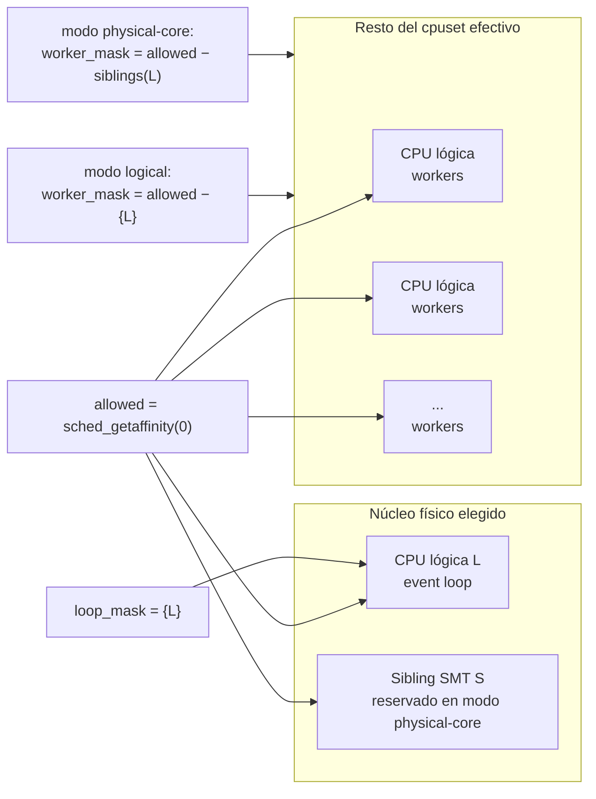
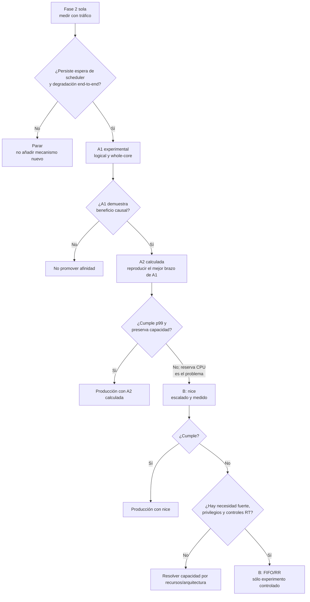

# Aislamiento del event loop sin sacrificar capacidad de workers en GoldenBridge

## Resumen ejecutivo

La mejor arquitectura de producción no es A1, A2 fija ni una política de tiempo real: es **A2 calculada, consciente de la topología y parametrizable entre aislamiento de una CPU lógica y aislamiento del núcleo físico completo**, pero sólo después de demostrar causalmente su valor mediante A1 y respetando el orden experimental **fase 2 → A1 → A2 → B**. A1 es el mejor actuador experimental porque permite modificar exclusivamente la colocación de los hilos y volver al estado anterior con poca fricción; A2 calculada es el mejor mecanismo permanente porque la afinidad es un atributo por hilo, puede aplicarse sin privilegios al propio hilo y puede derivarse del conjunto de CPU que el proceso realmente tiene permitido. En cambio, una A2 fija que suponga `CPU 0`, `CPU 8` u otra numeración absoluta no es suficientemente portable frente a cpusets/cgroups: Linux intersecta la máscara solicitada con las CPU realmente permitidas, y `cpuset.cpus.effective` puede ser distinto del conjunto solicitado por el contenedor. citeturn14view0turn16view3

La mejora avanzada que propondría respecto de un simple “reservar un core” es separar dos preguntas que suelen confundirse. La primera es **si el loop necesita una CPU lógica exclusiva**. La segunda es **si además necesita que quede libre su sibling SMT**. Los dos hilos lógicos de un núcleo SMT comparten recursos del núcleo físico; trabajos sobre cargas sensibles a latencia muestran que la coejecución SMT puede producir interferencia y degradaciones no lineales de cola. Por eso, reservar automáticamente ambos hilos lógicos maximiza el aislamiento, pero también maximiza el coste de capacidad. La decisión correcta debe salir de un A1 con dos brazos: `logical-only`, donde el loop monopoliza una CPU lógica pero el sibling sigue disponible para workers, y `whole-core`, donde los workers quedan fuera de todo el grupo de siblings. citeturn14view4turn14view0

**B con `nice` es una alternativa válida cuando A demuestra que la latencia mejora pero la reserva de CPU perjudica el throughput bajo saturación.** En Linux el nice es actualmente por hilo, de modo que puede favorecer específicamente al event loop sin inmovilizar un core; pero un nice negativo no es necesariamente utilizable por un proceso no privilegiado: hace falta `CAP_SYS_NICE` o un `RLIMIT_NICE` que lo permita. Y el mecanismo redistribuye CPU, no la crea: a saturación, dar más peso al loop significa potencialmente restárselo a workers. citeturn15view1turn14view1

**B con `SCHED_FIFO`/`SCHED_RR` no debería ser la política normal de GoldenBridge.** Los hilos de tiempo real tienen prioridad estrictamente superior a `SCHED_OTHER`; `SCHED_FIFO` puede continuar hasta bloquear, ser preemptado por una prioridad RT superior o hacer `sched_yield()`, y `SCHED_RR` sólo añade un quantum entre hilos de la misma clase/prioridad. Por tanto, que el loop sea el único hilo RT no implica que RR vaya a “ceder justamente” CPU a los workers `SCHED_OTHER`: éstos siguen en una clase inferior. Además, elevarse a RT requiere `CAP_SYS_NICE` o un `RLIMIT_RTPRIO` apropiado. citeturn14view1turn16view6

La conclusión práctica es:

**A1 para probar → A2 calculada para producir → `nice` como alternativa de preservación de capacidad → FIFO/RR sólo como último experimento controlado. A2 fija queda descartada salvo que GoldenBridge se comprometiera deliberadamente con un host de topología inmutable.**

Hay además dos precauciones críticas. Primero, los threads creados con `pthread_create()` heredan una copia de la affinity mask del thread creador; pinnear el loop antes de que aparezcan workers lazy puede hacer que esos workers nazcan accidentalmente dentro de la CPU exclusiva del loop. citeturn15view0 Segundo, **matar el helper de A1 no revierte por sí mismo las afinidades ya escritas**: `sched_setaffinity()` cambia un atributo persistente del hilo objetivo. Un rollback correcto debe restaurar explícitamente las máscaras guardadas o reiniciar el servicio; matar el helper sólo impide futuras reaplicaciones. citeturn14view0

Los datos y la restricción de atribución específicos de GoldenBridge refuerzan el orden: la fase 2 elimina una fuente de threads competidores que ataca la misma causa que la afinidad, por lo que debe medirse sola antes de introducir cualquier cambio de scheduling. El documento del proyecto exige precisamente una variable por campaña. fileciteturn0file0

## Supuestos y marco técnico

La recomendación parte de varios **supuestos explícitos**, porque de lo contrario sería fácil convertir preferencias de diseño en falsos hechos.

| Supuesto | Consecuencia para la decisión |
|---|---|
| GoldenBridge continúa siendo un proceso Linux multihilo con un único thread que ejecuta el event loop. | Afinidad y prioridad por TID son mecanismos apropiados. |
| Los workers son trabajo útil CPU-bound o parcialmente CPU-bound y pueden acercarse a saturación. | Reservar capacidad tiene un coste potencial real; no basta mirar la latencia del loop. |
| No se ha especificado un SLO contractual absoluto de p99. | Los umbrales propuestos abajo son **gates experimentales relativos**, no SLO de negocio. |
| La versión y configuración exactas del kernel de futuros despliegues no están fijadas. | El diseño no debe depender de detalles finos de una versión concreta del fair scheduler. |
| El entorno Modal futuro puede no exponer la misma numeración/topología/capabilities que una VM convencional. | Afinidad y RT deben someterse a feature detection en startup; nunca inferirse por plataforma. |
| La fase 2 es un cambio independiente pendiente de medición bajo tráfico. | Se mantiene estrictamente antes de A1, tal como exige la restricción experimental del proyecto. fileciteturn0file0 |

En Linux, la affinity mask pertenece al **thread**, no al proceso entero. `sched_setaffinity(0, ...)` actúa sobre el hilo que hace la llamada; el kernel sólo deja ejecutar ese hilo en la intersección entre la máscara pedida, las CPU presentes y las CPU admitidas por mecanismos como cpuset. Esa intersección puede aplicarse silenciosamente, por lo que un `setaffinity()` exitoso no sustituye a leer de vuelta la máscara efectiva. Para hilos del mismo usuario, la afinidad puede modificarse sin `CAP_SYS_NICE`; la capability es necesaria cuando las credenciales no cumplen las condiciones documentadas. citeturn14view0

Cgroup v2 refuerza la necesidad de calcular en lugar de hardcodear. `cpuset.cpus.effective` representa las CPU online **realmente concedidas** al cgroup por su jerarquía; no tiene por qué coincidir con lo solicitado. El mismo controlador publica `cpu.stat`, incluyendo `nr_throttled` y `throttled_usec`, y `cpu.pressure` expone PSI de CPU. Eso significa que una campaña de afinidad en contenedor debe distinguir “el loop espera porque compite con los workers” de “todo el contenedor está siendo throttled por su cuota”; si no se miden ambas cosas, una caída de throughput podría atribuirse erróneamente a la máscara de workers. citeturn16view3turn16view4turn16view5

Modal añade dos hechos relevantes. Su documentación actual expresa las solicitudes de CPU en **cores físicos, no vCPUs**, y configura automáticamente variables como `OPENBLAS_NUM_THREADS`, `OMP_NUM_THREADS`, `MKL_NUM_THREADS` y `ORT_INTRA_OP_NUM_THREADS` en función de la petición. También aplica un límite CPU que, al superarse, produce throttling del contenedor. Esto hace especialmente sensato tratar el control de threads de fase 2 y la asignación de recursos del contenedor como parte del mismo presupuesto de capacidad, aunque deban medirse en campañas distintas para conservar atribución. citeturn16view0turn16view1

Modal declara además que sus trabajos de cómputo están virtualizados y aislados mediante gVisor. Eso **no demuestra que `sched_setaffinity()` o las políticas RT estén prohibidas**, pero sí impide asumir equivalencia perfecta con una VM Linux desnuda: el código portable debe probar en startup qué syscalls, topología sysfs y capabilities están disponibles y degradarse de forma segura ante `EPERM`, `EINVAL`, información de topología incompleta o read-back inesperado. citeturn16view9turn15view5

El aspecto SMT merece tratarse como una variable experimental, no como una regla dogmática. La documentación de afinidad de Linux señala beneficios por dedicar una CPU y por evitar migraciones, pero compartir un núcleo físico mediante SMT es otra dimensión: dos CPUs lógicas pueden competir por recursos microarquitectónicos. El trabajo Elfen, presentado en USENIX ATC, estudia precisamente el préstamo de recursos SMT entre workloads batch y sensibles a latencia y encuentra que la coejecución puede comprometer objetivos de latencia de forma no lineal. No demuestra qué ocurrirá en GoldenBridge, pero sí justifica que `sibling ocupado` frente a `sibling libre` sea un factor explícito del experimento. citeturn14view0turn14view4

Finalmente, hay dos tipos distintos de herencia que deben estar en el diseño. Para afinidad, `pthread_create()` copia la affinity mask del creador. Para políticas y prioridades POSIX de scheduling, el atributo predeterminado de un `pthread_attr_t` recién inicializado es `PTHREAD_INHERIT_SCHED`, por lo que un thread puede heredar política y prioridad del thread creador salvo que la biblioteca use atributos explícitos. Esto vuelve peligroso aplicar afinidad estrecha o RT al main thread **antes** de que se hayan creado o configurado correctamente sus pools. citeturn15view0turn16view8

## Evaluación comparada de A1, A2 y B

La siguiente tabla resume la decisión. “Riesgo p99” significa riesgo de empeorar la cola end-to-end aun cuando mejore la latencia interna del event loop.

| Opción | Privilegios | Portabilidad | Riesgo de regresión p99 | Facilidad de rollback | Complejidad de implementación | Evidencia necesaria |
|---|---|---|---|---|---|---|
| **A1 — afinidad experimental** | Bajo: mismo UID suele bastar para los TID propios. citeturn14view0 | Media; depende de descubrir cpuset/topología en cada host | **Medio**: puede quitar capacidad a workers, sobre todo en `whole-core` | **Muy alta**, si guarda y restaura máscaras; restart también restaura un proceso nuevo | Baja-media: helper + detección de threads lazy + snapshot/restore | Caída de `wait_ratio`/wakeup-to-run + mejora p99 end-to-end sin caída material de throughput |
| **A2 fija** | Bajo para autoafinidad | **Muy baja** en cgroups/contenedores; IDs absolutos no son una interfaz estable de capacidad | **Alto**: máscara equivocada, sibling equivocado o reducción inesperada de pool | Alta con feature flag/redeploy, pero mala si falla al arrancar | Baja en código, alta en riesgo operacional | Demostrar que la topología y cpuset son invariantes en **todos** los destinos |
| **A2 calculada** | Bajo para el propio thread; mismo UID para otros TID | **Alta dentro de Linux**, si usa máscara efectiva + topología real + fallback | **Medio-bajo tras validación**, porque puede preservar una política `logical-only` | Alta con modo `off` y read-back | **Media-alta**: descubrimiento, inicializadores, auditoría, fallback | Equivalencia con A1 y cero violaciones de máscara después del warm-up |
| **B — nice** | Nice negativo: `CAP_SYS_NICE` o `RLIMIT_NICE` suficiente. citeturn15view1 | Media; semántica Linux clara, disponibilidad de privilegio no garantizada en contenedor | **Medio**: no reserva CPU, pero desplaza tiempo de workers | Alta; volver a nice normal reduce prioridad | Baja-media | Que recupere capacidad perdida por A manteniendo la mayor parte de la mejora de cola |
| **B — FIFO/RR** | `CAP_SYS_NICE` o `RLIMIT_RTPRIO`; políticas/cgroup pueden añadir restricciones. citeturn16view6turn14view1 | **Baja-media**; la política existe en Linux, pero capabilities y RT bandwidth varían | **Muy alto**: posibilidad de starving de workers o colas extremas | Lógicamente alta, operacionalmente peor si el hilo RT se descontrola | Alta por guardrails, límites, herencia y observabilidad | Beneficio p99 incremental que `nice` no consiga, cero starvation y márgenes RT demostrados |

**A1.** Su valor principal no es ser una arquitectura elegante, sino ser un **instrumento causal**. Permite hacer el ensayo que realmente responde al conflicto de capacidad: mantener constante el número de workers y comparar `sin afinidad`, `loop en CPU lógica exclusiva con sibling compartido` y `loop en núcleo físico completo`. Como la affinity mask es por thread, no hace falta restringir globalmente al proceso. citeturn14view0

A1 debe mejorarse respecto del patrón habitual de “script que repasa TIDs para siempre”. Antes de cargar el servidor conviene crear o calentar todos los pools conocidos, tomar un snapshot de cada máscara, poner primero a los workers en su máscara correcta y **pinnnear el loop al final**. Después, el helper sólo necesita detectar threads nuevos y corregirlos. El motivo es concreto: un nuevo pthread copia la máscara del creador. Poner primero `{L}` en el main thread y crear después el pool introduce una carrera en la que el supuesto worker puede nacer sobre `{L}`. citeturn15view0

El rollback de A1 debe ser transaccional: `snapshot → aplicar → verificar → experimentar → restaurar`. La idea de que basta con “matar el script” es técnicamente insuficiente, porque la máscara vive en los threads objetivo, no en el helper. Al terminar una campaña deben restaurarse todas las máscaras de los TID aún existentes, y ante duda el procedimiento más limpio es reiniciar el proceso con A1 deshabilitado. citeturn14view0

**A2 fija.** La descartaría como diseño general. Incluso si un host concreto presenta hoy una relación `CPU 0 ↔ CPU 8`, Linux permite que cpuset limite silenciosamente el conjunto efectivo, y el cgroup declara explícitamente cuáles CPU fueron realmente concedidas mediante `cpuset.cpus.effective`. Un ID fijo puede dejar de existir en el conjunto del contenedor, y aun cuando exista, no hay garantía general de que conserve la misma relación SMT al trasladar la aplicación. citeturn14view0turn16view3

A2 fija sólo es defendible en un escenario mucho más estrecho: máquina inmutable, topología contractual, sin destino containerizado diferente, y startup que haga **hard fail** si `{loop_cpu, sibling_cpu}` no coincide con las invariantes esperadas. Es una optimización específica de plataforma, no una política portable.

**A2 calculada.** Es la opción de producción recomendada porque transforma la topología en dato de runtime. Linux exporta información de topología de CPU mediante sysfs, incluyendo identificadores de core y mapas/listas de siblings; combinándola con `sched_getaffinity()` se puede construir el conjunto de cores físicos **que están enteramente visibles dentro del cpuset efectivo**, en vez de razonar sobre números absolutos. citeturn14view7turn14view0

La mejora decisiva es hacer A2 **configurable en anchura de reserva**. En modo `logical`, el loop usa `{L}` y los workers usan `allowed − {L}`; el sibling SMT de `L` sigue disponible para trabajo. En modo `physical-core`, el loop usa `{L}` pero los workers usan `allowed − siblings(L)`, dejando sin workers el resto del core físico. El primer modo preserva más capacidad; el segundo elimina la interferencia SMT más agresivamente. La campaña A1 decide cuál merece convertirse en el default de A2. La literatura sobre SMT sensible a latencia hace razonable esta comparación, pero no permite saltarse la medición específica. citeturn14view4

**B con nice.** Es más atractivo de lo que parece cuando la restricción dominante es capacidad: no excluye ninguna CPU de los workers y Linux/NPTL permite diferentes valores nice entre threads del mismo proceso. Sin embargo, sólo influye en la competencia dentro de la clase normal; no convierte al loop en un hilo de prioridad estricta. Un nice negativo requiere privilegio o `RLIMIT_NICE`, por lo que el diseño debe consultar el límite y hacer un intento controlado en startup, no asumir que `nice=-20` funcionará en Modal. citeturn15view1turn14view1

Tampoco empezaría en `-20`. La política experimental razonable es escalar, por ejemplo, desde `-5` y sólo aumentar si el diagnóstico de espera sigue fuera de objetivo. Los valores concretos son una elección de ingeniería, no una prescripción del kernel. El criterio no es “nice más bajo es mejor”, sino encontrar **la menor ventaja de scheduling que quite la cola del loop sin desplazar una cantidad apreciable de CPU desde el pool**.

**B con FIFO/RR.** Lo trataría como mecanismo excepcional. `SCHED_FIFO` de prioridad RT preempta inmediatamente a hilos normales y puede seguir ejecutando sin time slice hasta bloquear, ceder o ser desplazado por RT de prioridad superior. `SCHED_RR` añade un quantum, pero conserva las reglas de FIFO; su round-robin ordena threads que compiten a la misma prioridad RT, no crea fair sharing con `SCHED_OTHER`. Ésta es la razón por la que RR no constituye por sí sola una protección suficiente para los workers. citeturn14view1

Si se ensayara RT, lo haría empezando en la prioridad RT mínima soportada, no en 99; consultando `sched_get_priority_min/max`; aplicándolo sólo al TID del loop después de que los pools estén inicializados; haciendo que cada worker verifique explícitamente que sigue en `SCHED_OTHER`; y configurando `RLIMIT_RTTIME`. Este último limita el tiempo de CPU que un proceso bajo política RT puede consumir sin hacer una llamada bloqueante y existe precisamente como defensa útil frente a ejecución RT prolongada. citeturn14view1turn16view7

El coste operativo de las opciones refleja esa jerarquía. A1 cuesta automatización y vigilancia de threads efímeros; A2 calculada cuesta más código inicialmente pero menos operación diaria; A2 fija es barata de escribir y cara de portar; nice es barato si la plataforma concede el privilegio; FIFO/RR es caro de **operar con seguridad**, aunque la syscall que lo activa sea trivial.

## Diseño recomendado y degradación segura

El diseño de A2 debería partir de una regla sencilla: **GoldenBridge nunca elige números de CPU; elige un recurso topológico dentro de lo que el kernel dice que tiene permitido.**



La topología debe obtenerse de las interfaces que el host realmente exponga, agrupando CPUs por core físico y verificando `thread_siblings`/identificadores de topología. El cálculo empieza por `os.sched_getaffinity(0)` —o la syscall equivalente— porque ése es el conjunto efectivo desde la perspectiva del thread; las restricciones de cpuset pueden reducirlo respecto de lo que el host físicamente posee. citeturn14view0turn14view7turn16view3

El arranque robusto sería el siguiente:

1. **Descubrir capacidad efectiva.** Leer la affinity actual y, cuando exista, `cpuset.cpus.effective`. Registrar ambos, la topología física visible y el modo solicitado. La máscara devuelta por el kernel es la autoridad para lo que el thread puede usar. citeturn14view0turn16view3
2. **Construir grupos de siblings.** Sólo considerar “núcleo físico completo reservable” aquel para el que la topología permita identificar todos los siblings relevantes que están dentro del conjunto permitido. No inferir que `N + cantidad_de_cores` es el sibling.
3. **Aplicar un capacity floor.** Si reservar `{L}` o todo `siblings(L)` dejaría menos CPU para workers que un mínimo configurado, no activar ese modo. La política puede caer de `physical-core` a `logical`, y de `logical` a `off`.
4. **Crear/configurar los executors antes de estrechar el loop.** `ThreadPoolExecutor` ofrece un `initializer` ejecutado al iniciar cada worker; `asyncio` permite instalar un executor predeterminado explícito. Eso permite que el worker se autoasigne `worker_mask` al nacer, eliminando la necesidad de una carrera externa permanente para los workers gestionados por Python. citeturn14view5turn14view6
5. **Calentar los pools que sean lazy.** Después del warm-up, verificar los TID y sus máscaras. Sólo entonces pinnear el event loop a `{L}`. La secuencia evita que el riesgo documentado de herencia de affinity convierta accidentalmente un worker en competidor dentro de la CPU del loop. citeturn15view0
6. **Leer de vuelta, no confiar en el retorno de `setaffinity`.** La documentación de Linux advierte que cpuset puede imponer restricciones adicionales silenciosamente. Si la máscara efectiva del loop o de los workers no coincide con la política calculada, abortar la activación y volver a `off`. citeturn14view0
7. **Auditar threads tardíos.** Un muestreo de baja frecuencia de `/proc/self/task` debe detectar TID nuevos, clasificarlos cuando sea posible y comprobar sus máscaras. Un thread nativo desconocido no debería ser recolocado ciegamente; es mejor señalar `affinity_unclassified_thread=1` y degradar que aplicar una regla equivocada a un thread de biblioteca con requisitos propios.
8. **Exponer la política como configuración, no como fork de código.** Por ejemplo: `off`, `affinity-logical`, `affinity-core`, `nice`, `rt-test`. El rollback de A2 se convierte así en una operación de configuración/restart, no en un commit de emergencia.

En un entorno containerizado, la degradación segura debe ser **fail-open respecto de performance, fail-closed respecto de scheduling riesgoso**. Si falta topología de siblings pero funciona affinity, `affinity-core` no debe adivinar: puede caer a `affinity-logical` sólo si ese modo ya fue validado experimentalmente; en caso contrario, `off`. Si `sched_setaffinity()` devuelve `EPERM` o `EINVAL`, no debe impedir que el servidor arranque salvo que la organización haya decidido explícitamente que el aislamiento es requisito funcional. Los errores documentados incluyen tanto falta de privilegio como una máscara sin CPU permitidas. citeturn14view0

Para Modal aplicaría todavía más estrictamente esa regla. Modal documenta recursos en cores físicos y usa gVisor, pero no ofrece en la documentación citada un contrato que garantice a una aplicación IDs concretos de CPU, acceso a una topología SMT determinada ni `CAP_SYS_NICE`. Por tanto, **el soporte debe descubrirse ejecutando probes en el contenedor real**. citeturn16view0turn16view9

El probe debería producir, como mínimo:

```text
allowed_cpus
topology_source
physical_core_groups_visible
selected_loop_cpu
selected_sibling_set
loop_mask_actual
worker_mask_actual
sched_policy_loop
nice_loop
RLIMIT_NICE
RLIMIT_RTPRIO
RLIMIT_RTTIME
cgroup_cpu_max
cgroup_cpuset_effective
```

No hace falta que todos esos campos existan en cada plataforma: precisamente la ausencia forma parte del resultado de portabilidad.

Para B/nice, el modo seguro consulta primero el nice actual y `RLIMIT_NICE`, prueba el ajuste únicamente sobre el TID del loop y verifica después el valor efectivo. Linux/NPTL hace nice por thread, aunque POSIX lo especifica de otra forma; por eso esta optimización debe considerarse deliberadamente Linux-specific. citeturn15view1

Para B/RT, la degradación debe ser mucho más conservadora. Si no se puede demostrar que existe `CAP_SYS_NICE` o un `RLIMIT_RTPRIO` suficiente, el modo se desactiva. Si sí existe, se debe inspeccionar también la configuración de RT del host/cgroup y fijar un `RLIMIT_RTTIME`; los workers deben comprobar explícitamente que permanecen en clase normal. El default de `PTHREAD_INHERIT_SCHED` hace especialmente peligroso que el loop pase a RT y después cree threads sin atributos explícitos. citeturn16view6turn16view7turn16view8

Hay una variante avanzada que **no implementaría inicialmente**, pero que merece quedar en el diseño: aislamiento elástico. Sistemas de investigación como Caladan muestran por qué la partición estática de cores puede desperdiciar capacidad cuando una carga sensible a latencia es bursty, y exploran asignación dinámica de cores para reconciliar utilización con QoS. Es una dirección conceptual interesante para GoldenBridge —por ejemplo, reservar el sibling sólo cuando la presión del loop supera un umbral con histéresis—, pero introduciría migraciones, estado y una segunda política de control antes de haber caracterizado la solución estática. Primero hay que medir `logical` frente a `whole-core`; sólo después tendría sentido estudiar préstamo dinámico. citeturn4search0

## Programa experimental y confirmación causal

El programa debe conservar una única variable causal por campaña. La secuencia exigida por GoldenBridge —fase 2 antes que afinidad— no es sólo disciplina metodológica: fase 2 y afinidad reducen competencia de CPU sobre el mismo loop, por lo que aplicarlas juntas impediría conocer qué intervención produjo qué parte de la mejora. fileciteturn0file0



Dentro de **A1** haría dos tratamientos, manteniendo igual el número de workers y la carga:

`A1-logical`: `loop_mask={L}`; `worker_mask=allowed−{L}`.

`A1-core`: `loop_mask={L}`; `worker_mask=allowed−siblings(L)`.

Ese contraste es el experimento más importante para resolver **aislamiento versus capacidad**. La diferencia `baseline → A1-logical` mide principalmente el valor de eliminar competencia directa sobre la CPU lógica del loop. La diferencia `A1-logical → A1-core` estima el valor incremental de eliminar interferencia SMT, a cambio de retirar el sibling del pool. La evidencia de interferencia SMT en cargas sensibles a latencia justifica buscar ese efecto explícitamente. citeturn14view4

Las métricas deberían registrarse como deltas temporales sincronizados y por TID, no como snapshots acumulativos:

| Plano | Métrica exacta | Qué pregunta responde |
|---|---|---|
| Scheduler del loop | `Δschedstat_exec_ns` | ¿Cuánta CPU recibió realmente el loop? |
| Scheduler del loop | `Δschedstat_wait_ns` | ¿Cuánto tiempo runnable pasó en runqueue? |
| Scheduler del loop | `wait_ratio = Δwait / (Δexec + Δwait)` | ¿Qué fracción de su demanda de CPU fue espera? |
| Scheduler del loop | `Δwait_ns / Δtimeslices` | Espera media de runqueue por despacho, con las cautelas propias de una media |
| Scheduler del loop | `Δvoluntary_ctxt_switches`, `Δnonvoluntary_ctxt_switches` | ¿Cambió el patrón de bloqueo/preemption? |
| Scheduler avanzado | `sched_waking/sched_wakeup → sched_switch-in`, p50/p90/p99/p99.9 | Latencia desde que el loop está listo hasta que realmente corre |
| Aplicación | `resume_vad`, p50/p90/p99/p99.9 | Retraso visible inmediatamente alrededor de la reanudación del loop |
| Aplicación E2E | `cycle`/`cycle_p90` bruto disponible, p50/p90/p99 de su distribución | ¿La mejora local llega al ciclo completo? |
| Aplicación E2E | `turn_end_latency_ms`, p50/p90/p99 | Gate de experiencia punta a punta |
| Backpressure | `inbox_depth` p50/p90/p99/max y tiempo en cola p99 | ¿La CPU ahorrada al loop falta ahora en otro sitio? |
| Pool | profundidad de worker queue y `worker_queue_wait_ms` p50/p90/p99 | ¿Los workers están siendo starving? |
| Throughput | `completed_turns/s` y total por intervalo comparable | ¿Se preserva capacidad útil? |
| Fiabilidad | timeouts, drops, errores, sesiones abortadas | ¿La política falla de forma cualitativa? |
| Carga | `active_sessions` exacto | Variable principal de emparejamiento |
| Carga | frames/s, frames totales, barge-ins/s, tareas worker/s | Detecta cambios de trabajo efectivo |
| CPU | CPU-seconds por TID y por proceso / wall-time | ¿Quién gana y pierde capacidad? |
| SMT | utilización de `L`, su sibling y cores del pool | ¿El sibling compartido explica la cola? |
| Cgroup | `Δnr_throttled`, `Δthrottled_usec`, `cpu.pressure` | ¿La plataforma, y no la política de threads, está limitando CPU? |
| Integridad | affinity efectiva de cada TID | ¿El tratamiento aplicado coincide con el tratamiento nominal? |

Los tres primeros campos de `/proc/<pid>/task/<tid>/schedstat` proporcionan tiempo ejecutando, tiempo esperando en runqueue y número de timeslices en las versiones documentadas del scheduler stats, lo que convierte `wait_ratio` en una medición directa de presión de scheduling y no en una inferencia basada sólo en latencia de aplicación. citeturn15view6

Para una prueba causal más fuerte, añadiría tracing durante campañas cortas. Los tracepoints de scheduler permiten observar eventos de wakeup y switch; de ahí puede construirse la distribución **wakeup-to-run** del TID del event loop. El patrón causal esperado es: la intervención cambia primero esa distribución y `schedstat_wait`; después cambia `resume_vad`; y finalmente, si el fenómeno era relevante para el usuario, cambia la cola end-to-end. citeturn15view7

El emparejamiento por `active_sessions` no debe limitarse a calcular una media por campaña. Usaría **common support**: sólo se comparan niveles de concurrencia presentes en ambas campañas. Mantendría, para continuidad con GoldenBridge, los estratos existentes y dividiría el tramo de alta carga si el tamaño muestral lo permite, porque una única cesta `41–99` puede ocultar una rodilla interna. El documento del proyecto ya advierte que contar IDs rotados no representa simultaneidad y establece `active_sessions` como variable correcta. fileciteturn0file0

Dentro de cada estrato, la comparación debe aproximar trabajo con trabajo. En un generador sintético, lo ideal es reproducir la misma semilla/secuencia de sesiones y verificar frames, barge-ins y trabajo enviado al pool. En tráfico real, haría matching por `active_sessions` exacto o muy próximo y luego por ventanas con `frames/s`, barge-ins, tipo/duración de sesión y trabajo worker semejantes. También descartaría o etiquetaría ventanas donde la tasa de throttling de cgroup sea materialmente distinta. Las métricas `cpu.stat` y CPU PSI existen precisamente para distinguir escasez impuesta por el cgroup de competencia interna. citeturn16view4turn16view5

No promediaría “p99 de cada minuto” para producir otro p99. Siempre que sea posible, conservaría los eventos crudos de latencia y calcularía los cuantiles sobre el conjunto de observaciones emparejadas del estrato. Para incertidumbre, usaría bootstrap por bloques temporales o por sesión, evitando tratar miles de eventos correlacionados de una misma llamada como observaciones independientes.

La **confirmación causal** exigiría que aparezca esta cadena, en este orden lógico:

**misma carga efectiva → cambia la política de scheduling → cae el wakeup/runqueue delay del loop → cae la latencia interna del loop → no se desplaza la espera a los workers → mejora o no empeora el p99 end-to-end → throughput se conserva.**

Una caída de `resume_vad` sin cambio de `wait_ratio` sugeriría que el mecanismo actúa por otra vía o que la métrica no representa lo que se cree. Una caída de `wait_ratio` y `resume_vad` con aumento de `worker_queue_wait`, `inbox p99` y caída de throughput indicaría que el mecanismo **sí arregló el loop pero sólo trasladó la hambruna al pool**. Ese segundo resultado no invalida la hipótesis de scheduling; invalida la política como solución global.

Para A1-core hay una prueba causal adicional especialmente valiosa: si `A1-logical` mejora mucho respecto del baseline y `A1-core` sólo añade una mejora p99 pequeña mientras reduce throughput, el sibling debe mantenerse disponible. Si, en cambio, liberar el sibling produce otra caída fuerte en wakeup-to-run/p99 sin perjudicar la capacidad global, GoldenBridge tiene evidencia para reservar el núcleo físico completo. Esa decisión no debería hacerse a priori.

## Umbrales de aceptación y decisión final

Como no se proporcionó un SLO contractual absoluto, propongo **umbrales relativos de ingeniería**. Deben pre-registrarse antes de mirar los resultados para evitar escoger después el criterio que favorezca la variante deseada.

El gate universal para la franja donde se manifiesta el problema sería:

| Dimensión | Umbral propuesto |
|---|---|
| Causalidad scheduler | `wait_ratio` del loop **≥50 % menor** que fase 2 sola en carga alta, o una reducción de wakeup-to-run comparablemente clara |
| Latencia del loop | `resume_vad p99` **≥30 % menor**; p90 ≥20 % menor |
| Cola E2E | `turn_end_latency_ms p99` y la métrica de ciclo p99: **sin regresión >5 %** en estimación puntual; límite superior del IC 95 % < +10 % |
| Throughput | estimación puntual no peor de **−2 %**; límite inferior del IC 95 % mejor que −5 % |
| Backpressure | `inbox p99` y `worker_queue_wait p99`: no empeorar >10 % |
| Errores | ningún aumento material de timeouts/drops; cero episodios de starvation sostenido |
| Cgroup | no introducir un aumento sostenido de throttling/CPU pressure que explique el resultado |
| Integridad | cero violaciones de las máscaras esperadas después del warm-up |

El **50 % de reducción de espera** no es una ley universal: es un gate deliberadamente exigente porque una modificación del scheduler añade superficie operativa. Un efecto pequeño puede ser estadísticamente real y, aun así, no justificar código permanente.

Para decidir **A1-logical frente a A1-core**, elegiría `logical` siempre que su p99 quede dentro de aproximadamente un **10 % del beneficio de cola conseguido por `core`** y muestre mejor capacidad/worker headroom. El modo `core` sólo gana si su mejora adicional de p99 es material y los guardrails de throughput/backpressure siguen dentro de límites. Ésta es la regla que evita pagar dos CPUs lógicas por una mejora que quizá ya se obtuvo con una.

Para promover **A2 calculada**, no reabriría la pregunta causal. La campaña es de **equivalencia operativa con A1**: debe conservar al menos el 90 % de la mejora de latencia conseguida por el brazo A1 ganador, mantener throughput dentro de ±2 % de A1 y registrar cero workers nacidos con una máscara incorrecta después del periodo de inicialización. También debe pasar pruebas de reinicio, creación tardía de workers y cambios de cpuset cuando el entorno permita simularlos.

A2 calculada debe incluir un modo `off` y registrar por qué se degradó. Consideraría correctos fallbacks como:

| Condición detectada | Respuesta |
|---|---|
| No hay CPU suficiente para respetar el capacity floor | `off` |
| No se puede determinar el sibling | `physical-core → logical` sólo si `logical` fue validado; de lo contrario `off` |
| `sched_setaffinity` falla con `EPERM`/`EINVAL` | Restaurar estado y `off` |
| Read-back de máscara ≠ política esperada | Restaurar y `off` |
| Aparece un worker con máscara del loop | Corregir si su rol es inequívoco; marcar campaña inválida si ocurrió bajo medición |
| Cambio de PID/restart | Rehacer discovery desde cero; nunca reutilizar IDs/topología cacheados |

Para **B/nice**, el criterio debería ser comparativo contra A, no simplemente contra baseline. Sólo lo escogería si A demuestra un coste de capacidad real. Propongo exigir que nice conserve **al menos ~80 % de la mejora en scheduler delay de A1** y, al mismo tiempo, recupere una parte sustancial del throughput/headroom perdido al reservar CPU, sin romper los guardrails p99. De lo contrario A2 es más determinista y ya tiene la ventaja experimental. La necesidad de `CAP_SYS_NICE` o `RLIMIT_NICE` para prioridades nice negativas también debe formar parte del test de despliegue. citeturn15view1

Para **FIFO/RR**, el listón debe ser mucho más alto: no basta superar al baseline. Sólo justificaría el riesgo si nice no alcanza el p99 requerido y RT produce una **mejora adicional material**, por ejemplo ≥20 % en el p99 primario de alta carga, con cero episodios de starvation, cero agotamientos de `RLIMIT_RTTIME`, cero crecimiento material de la cola worker/inbox y throughput dentro de los mismos límites. La prioridad inicial debería ser la mínima RT posible que produzca el efecto; las prioridades soportadas se consultan al sistema, y la clase RT siempre está por encima de los threads normales. citeturn14view1turn16view6

Un detalle operativo importante inclina todavía más la balanza contra RT: la seguridad no puede depender exclusivamente de que “el propio loop revierta su prioridad si algo sale mal”. Si el fallo consiste precisamente en que ese thread deja de bloquear y monopoliza CPU disponible frente a sus workers, el actor que debería corregirlo forma parte del fallo. `RLIMIT_RTTIME` ofrece una protección kernel-level útil frente a consumo RT prolongado sin bloqueo; debe existir junto a cualquier watchdog externo, no ser sustituido por él. citeturn16view7

La matriz final de decisión queda así:

**A1** es el mecanismo de laboratorio/prod-canary para establecer causalidad y, crucialmente, cuantificar por separado el precio del sibling SMT.

**A2 fija** no debe convertirse en GoldenBridge estándar. Linux y cgroups no dan base para considerar IDs absolutos una abstracción portable, y Modal expresa capacidad en cores físicos en lugar de prometer una numeración lógica concreta. citeturn16view3turn16view0

**A2 calculada** es el objetivo de producción: `allowed` derivado del kernel, topología descubierta, reserva `logical` o `physical-core` elegida por evidencia, workers autoafinados al nacer, read-back obligatorio, capacity floor, modo `off` y telemetría de integridad. Es el mecanismo que mejor combina determinismo, portabilidad Linux, rollback y coste operativo una vez implementado. citeturn14view0turn15view0turn14view5

**B/nice** es la alternativa estratégica cuando A resuelve la cola pero la reserva de CPU se vuelve demasiado cara en la zona de saturación. Su ventaja es preservar todas las CPU en el dominio de ejecución; su desventaja es que sólo redistribuye preferencia y depende de privilegios para valores negativos. citeturn15view1

**B/FIFO-RR** queda como último recurso para un requisito de latencia que A2 y nice no puedan cumplir. Técnicamente es potente; precisamente por eso tiene el peor perfil de fallo. `SCHED_RR` no neutraliza ese riesgo frente a workers `SCHED_OTHER`, y cualquier ensayo debe controlar privilegios, herencia, RT limits y starvation de forma explícita. citeturn14view1turn16view8turn16view7

La recomendación definitiva, por tanto, es **no plantear “aislamiento o capacidad” como una elección binaria**. GoldenBridge puede medir el precio de cada capa de aislamiento: primero quitar competencia innecesaria con fase 2; luego reservar sólo una CPU lógica con A1; después comprobar cuánto compra adicionalmente silenciar el sibling SMT; y únicamente codificar en A2 calculada el nivel mínimo de aislamiento que satisfaga el p99. Si incluso ese nivel mínimo consume capacidad indispensable, el siguiente experimento correcto es nice. Sólo si la prioridad normal no basta y existe un SLO que justifique explícitamente mayor riesgo tiene sentido entrar en FIFO/RR. Ese orden conserva atribución, evita hardcodes incompatibles con cgroups y convierte la tensión entre latencia del coordinador y throughput del pool en una variable medible, en lugar de una decisión arquitectónica por intuición. fileciteturn0file0